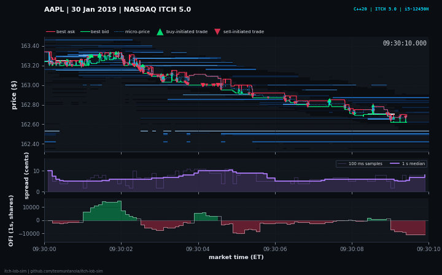

# itch-lob-sim



L2 order book simulator in C++20. It replays NASDAQ TotalView-ITCH 5.0 historical data for one symbol, rebuilds the book from per-order (L3) events, measures the latency of every book update, and exports best bid/offer and market depth to CSV.

```
ITCH 5.0 file ──► parser ──► order book (L2 ladder) ──► latency percentiles
                                   └──► BBO / depth CSV
```

## Build

Requires a C++20 compiler (GCC 11+, Clang 14+, MSVC 2022) and CMake 3.20+.

```bash
cmake -S . -B build            # Release by default, tuned for the host CPU
cmake --build build -j
ctest --test-dir build --output-on-failure
```

Pass `-DITCH_NATIVE=OFF` to build without `-march=native` (what CI does).

## Run

### 1. Without real data (synthetic stream)

```bash
./build/gen_synthetic 5000000 42 synth.itch      # 5M messages, seed 42, symbol "TEST"
./build/itch_sim --symbol TEST --bbo bbo.csv --depth depth.csv synth.itch
```

The synthetic stream is for testing and stress only: the mid price jumps every 100k messages to force window re-centering, and old orders are never cleaned up, so the final book can be crossed. Do not quote its numbers.

### 2. With real NASDAQ data

NASDAQ publishes free sample ITCH 5.0 files (one trading day, several GB compressed). Download one and stream it, without decompressing to disk:

```bash
gzip -dc 01302019.NASDAQ_ITCH50.gz | ./build/itch_sim --symbol AAPL --bbo aapl_bbo.csv --depth aapl_depth.csv -
```

Options: `--levels N` (depth levels, default 5), `--depth-ms N` (market-time interval between depth snapshots, default 1000), `--pin CPU` (pin to a core, Linux only).

### Output

```
symbol            : AAPL (locate 13)
messages          : ... total, ... for symbol, ... unsupported types
wall time         : ...
book update (ns)  : n=...  min=...  p50=...  p90=...  p99=...  p99.9=...  p99.99=...  max=...
book              : ... live orders, ... recenters, ... unknown refs
final BBO         : ...
```

`bbo.csv`: `ts_ns,bid_px,bid_qty,ask_px,ask_qty` (a row each time the BBO changes; `ts_ns` is nanoseconds since midnight).
`depth.csv`: `ts_ns,side,level,price,qty` (long format, top N levels per side).

### Visualizing the book

`--trades FILE` writes every execution (resting-order price, shares, side) and `--from` / `--to` (market time, `HH:MM:SS`) limit the CSV exports to a window, so a day-long replay does not produce a day-long CSV. Timing is not affected: exports happen after the stop timestamp.

```bash
./build/itch_sim --symbol AAPL --from 09:30:00 --to 09:32:00 --depth-ms 100 --levels 20 \
    --bbo bbo.csv --depth depth.csv --trades trades.csv 01302019.NASDAQ_ITCH50
python3 tools/plot_book.py --depth depth.csv --bbo bbo.csv --trades trades.csv \
    --title "AAPL, 30 Jan 2019, NASDAQ ITCH 5.0" --out dashboard.png --gif dashboard.gif
```

The dashboard has three panels on a shared market-time axis: (1) resting liquidity per price level (top 20 levels per side) with the best bid and ask, the micro-price and executions; (2) the quoted spread in cents; (3) order flow imbalance (Cont, Kukanov, Stoikov) summed over a rolling 1 s window. Executions: green triangle = a resting ask was executed (buyer initiated), red triangle = a resting bid was executed (seller initiated). `--badge` adds a short caption (for example measured latency with the hardware) and `--no-heatmap` hides the liquidity background. It needs `python3`, `numpy` and `matplotlib`. For `C` messages (executed at a price different from the displayed one) the exported price is the order's displayed price.

## Design

- **Parser** (`include/itch/parser.hpp`): decodes ITCH 5.0 messages `R A F E C X D U` (big-endian, BinaryFILE framing with a 2-byte length prefix). Everything else is counted as unsupported and skipped. `read_frames` works on files and pipes.
- **Order book** (`include/itch/order_book.hpp`): per-order lookup in a flat open-addressing hash table (16-byte slots, linear probing, backward-shift delete; the order reference is used directly as the index because ITCH references are near-sequential); per-side dense price ladder over a window of 4096 ticks ($40.96 at $0.01 tick) plus a sparse overflow map for levels outside it. When the mid leaves the central half of the window, the book **re-centers** (rebuilds the ladder around the new mid). The best price is cached per side and only recomputed when the best level empties.
- **Latency** (`include/itch/latency.hpp`): two monotonic clock reads around each book update; all samples are stored and exact percentiles (nearest-rank) are computed at the end. CSV export happens after the stop timestamp, so it is not in the measurement. The measured timer overhead is printed and is included in every sample.
- **Tests** (`tests/test_main.cpp`): parser field decoding, stream framing across buffer refills, book operations, re-centering, and a randomized cross-check of 200k operations against a naive `std::map` reference book (best bid/offer every step, depth every 25 steps). The flat hash table is cross-checked against `std::unordered_map` over 1.8M random operations.

## Limitations

- Single symbol per run; one tick size for the whole book (default $0.01, prices are quantized down to it, so sub-penny orders are merged into the penny below).
- Only add / execute / cancel / delete / replace messages are applied. Trade messages (`P`, `Q`, `B`), halts, and auction/cross events are ignored.
- The order table uses the key as its hash index (see Benchmarks). That suits ITCH order references, which are increasing and, for any one symbol, sparse (AAPL is 0.45 % of the messages on 30 Jan 2019), but it is fragile for dense keys: on a single-symbol synthetic stream with *consecutive* references, p99 was about 15 us against 0.4 us for a multiplicative hash (Linux container, 5M messages), because backward-shift deletion scans the whole probe cluster. `gen_synthetic` therefore uses sparse references. The table also grows by doubling, which causes rare millisecond-scale pauses; it is pre-sized for 131,072 live orders.

## Benchmarks

Replay of the NASDAQ ITCH 5.0 sample file `01302019.NASDAQ_ITCH50` (30 Jan 2019), symbol AAPL: 368,366,634 messages in the file, 1,656,597 of them applied to the AAPL book.

Latency is the wall time of one book update: two `steady_clock` reads around the call, so about 36 ns of clock overhead is included in every sample. Process pinned to logical CPU 3, input read from an already-decompressed file.

### Order table: `std::unordered_map` vs flat open-addressing table

5 rounds; in each round the builds were run back to back, so comparisons are paired within a round. Values are medians over the 5 rounds (min - max in brackets), in ns.

| Percentile | `std::unordered_map` | Flat table (key as index) | Change (paired median) |
|---|---|---|---|
| p50 | 127 (72 - 130) | 99 (61 - 118) | -19 % |
| p90 | 397 (266 - 486) | 275 (207 - 323) | -24 % |
| p99 | 1,115 (794 - 1,527) | 622 (406 - 632) | -53 % |
| p99.9 | 4,450 (2,206 - 4,949) | 2,736 (1,317 - 2,854) | -42 % |

The flat table was better in all 5 rounds at p50, p90, p99 and p99.9. The host sped up between rounds 3 and 4 (every build got about 40 % faster), which is why the absolute ranges are wide: compare builds within a round, not across rounds.

A first version with Fibonacci hashing was **34 % slower at p50** than `std::unordered_map` (while 57 % better at p99). The likely cause, not isolated with a profiler, is locality: ITCH order references are close to sequential and `std::hash` on an integer is the identity, so consecutive orders sit in neighbouring cache lines; a multiplicative hash scatters them. Using the key directly as the index fixed the median. Probe lengths were not instrumented, only end-to-end latency, and a key-as-index hash can cluster on other key patterns.

p99.99 and max are not reported: they swing by 3x between runs and are dominated by OS scheduling noise on Windows/WSL2. Table growth also shows up as rare millisecond-scale outliers in the max.

**Setup:** Intel Core i5-12450H (12 logical CPUs), 7.6 GiB RAM visible to WSL2, Windows host running WSL2 Ubuntu (kernel 6.18.40.1-microsoft-standard-WSL2), GCC 15.2.0, CMake Release build with `-march=native`.

**Sanity checks on the full day:** 0 unknown order references, empty book at the close, and 552,947 BBO changes between 09:35 and 15:55 with 0 crossed quotes and a mean quoted spread of $0.0232 (averaged per event, not per unit of time).

**Reproduce:**

```bash
gzip -dk 01302019.NASDAQ_ITCH50.gz        # ~11 GB decompressed
for i in 1 2 3 4 5; do ./build/itch_sim --symbol AAPL --pin 3 01302019.NASDAQ_ITCH50 | grep "book update"; done
```

## Layout

```
include/itch/   types, parser, order_book, latency, pipeline
src/            order_book.cpp, latency.cpp, main.cpp
tools/          gen_synthetic.cpp, plot_book.py
tests/          test_main.cpp
.github/        CI (Linux, macOS, Windows)
```
